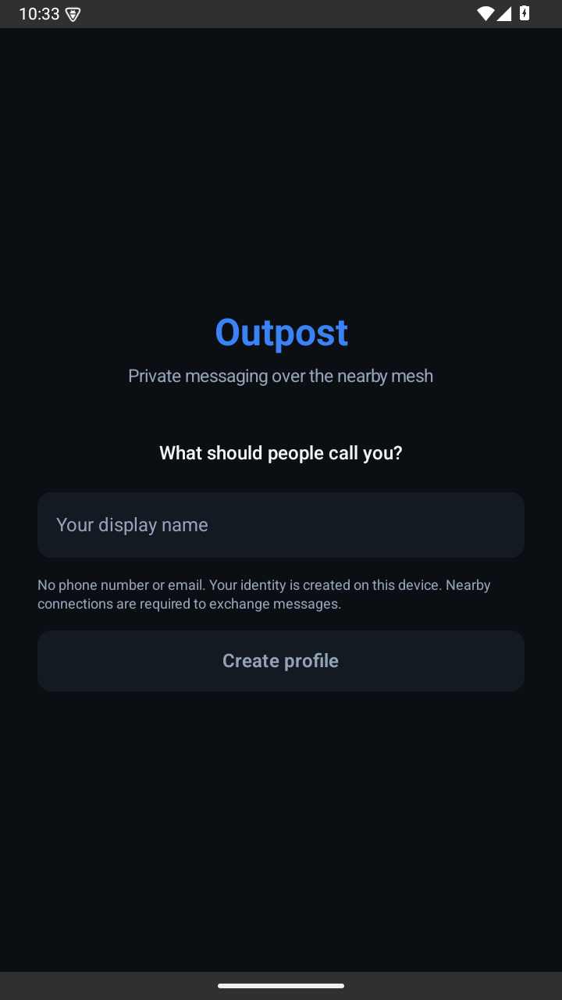
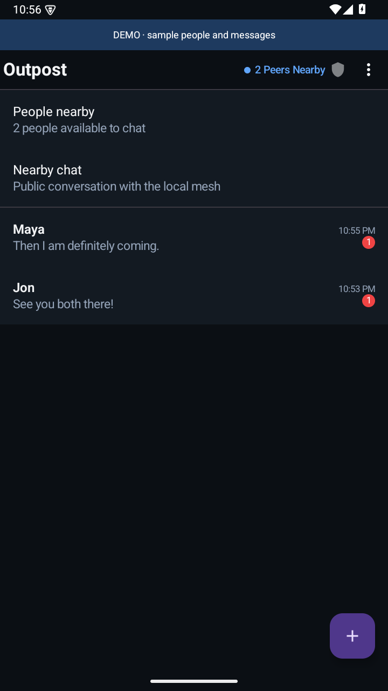
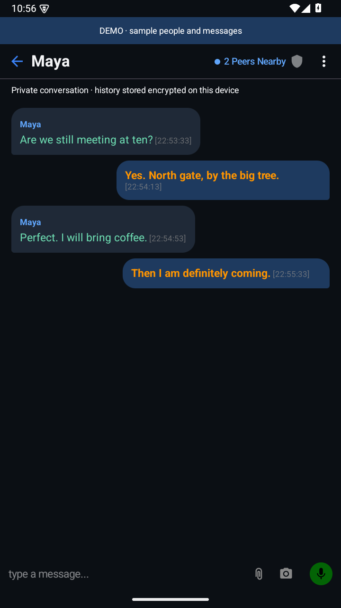
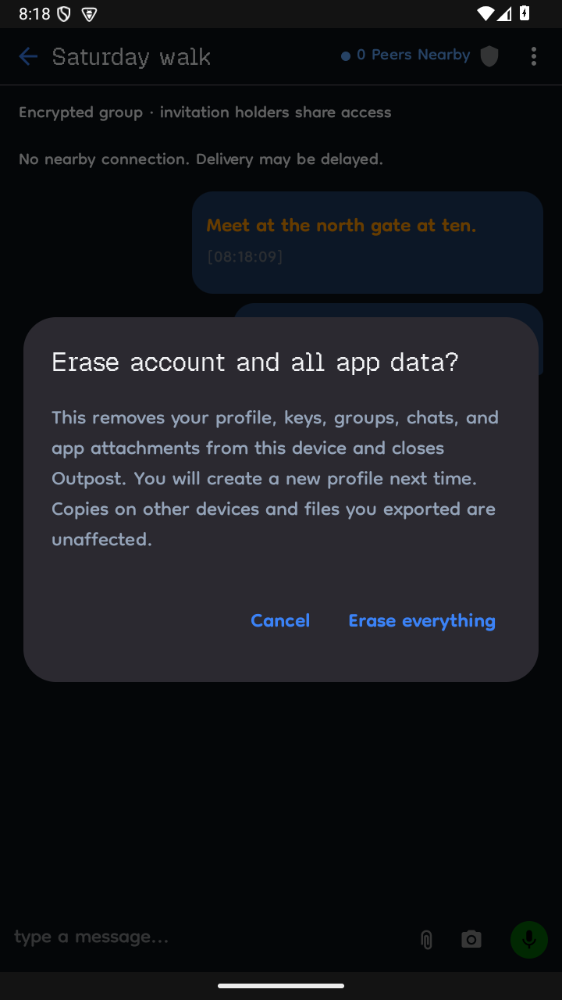

# Purpose

**We want people to stay in touch when the internet goes down.**

To find a friend at a protest. Share a secret. Or say hello to someone nearby.

That’s why we’re building Outpost on BitChat, using the radios already in our phones. No phone number or email needed.

## How

Choose a name, enable Bluetooth, and allow the nearby connection permissions. Find someone nearby and start a private chat. For a group, share an invitation link or QR code with the people you want there.

Participating phones can carry messages through the mesh without mobile data or WiFi. Reach depends on nearby devices, distance, walls, batteries, and Android’s background rules. An invitation alone cannot connect distant phones.

## What

* Encrypted private conversations and invited groups.
* Small photos, files, and short voice notes.
* Encrypted text history kept on your phone.
* Controls to clear a chat, leave a group, or erase your profile and app data from this device.

### See it

<a href="docs/images/profile.png"></a>
<a href="docs/images/nearby-demo.png"></a>
<a href="docs/images/chat-demo.png"></a>
<a href="docs/images/erase.png"></a>

Captured in an Android emulator. contacts and messages. Tap to enlarge.

### Know the limits

Public chat is visible to the mesh. Anyone with a group invitation can read, send, and invite others. Erasing removes app data from this device; other people’s copies and your exported files remain.

**Release candidate.** Physical Bluetooth delivery still needs validation, and release signing is pending. There has been no independent security audit. Read the [validation report](docs/single-device-validation.md) before relying on it for sensitive conversations. Private text is limited to 255 encoded bytes and files to 96 KB.

### Try it

Requires Android 8 or newer with Bluetooth Low Energy. To build, use JDK 17 and Android SDK 35:

```bash
./gradlew assembleDebug
```

[Build and test](docs/development.md) · [Validation](docs/single-device-validation.md) · [About](ABOUT.md) · [License](LICENSE.md)

Built on the work of BitChat and its contributors. Open source under GPLv3.
